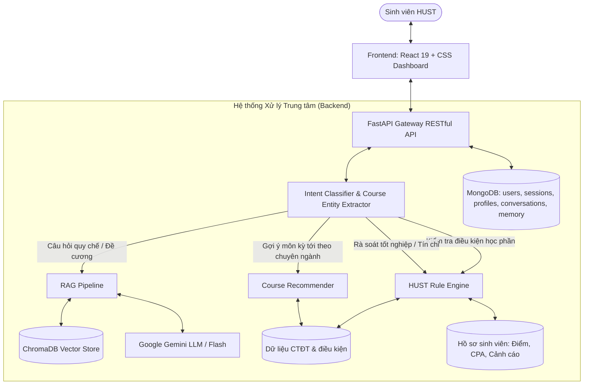

# HUST Course Advisor & Degree Audit Engine

> **Đồ án 1 (HUST - 2026.1):** Hệ thống Chatbot và Dashboard tư vấn học tập, chọn môn và rà soát tiến độ cho sinh viên Đại học Bách Khoa Hà Nội. Bản thử nghiệm hỗ trợ CTĐT ET1–2022 và ET1–2023 (đã đối chiếu thủ công) cùng 10 CTĐT nhập từ tài liệu công khai qua kiểm tra tự động.  
> **Sinh viên thực hiện:** Mai Duy Hiếu  

---

## 📌 Giới thiệu đề tài

Hệ thống **HUST Course Advisor** là một giải pháp ứng dụng trí tuệ nhân tạo lai (**Hybrid AI Agent**) nhằm giải quyết bài toán tư vấn học tập, lựa chọn môn học và rà soát tiến độ tốt nghiệp cho sinh viên Bách Khoa:
1. **RAG Pipeline (Retrieval-Augmented Generation):** Kết hợp mô hình Gemini LLM với cơ sở dữ liệu vector ChromaDB để giải đáp quy chế đào tạo, chuẩn đầu ra và đề cương môn học chính xác có kèm trích dẫn nguồn.
2. **Deterministic Rule Engine:** Sử dụng dữ liệu CTĐT và bộ quy tắc HUST để kiểm tra điều kiện học phần, rà soát tín chỉ (Degree Audit) theo từng hồ sơ sinh viên và hỗ trợ chọn môn.
3. **Full-stack Interactive Dashboard:** Giao diện React tập trung vào chat tự nhiên, tiến độ học tập và gợi ý chọn môn theo các mô-đun của chương trình đào tạo đang được hỗ trợ.

---

## 🏛️ Kiến trúc hệ thống (System Architecture)



## ✨ Chức năng chính

- **Tài khoản riêng cho từng sinh viên:** đăng ký và đăng nhập bằng MSSV + mật khẩu; phiên nằm trong cookie HttpOnly, mỗi người chỉ thấy hồ sơ, bảng điểm và hội thoại của mình.
- **Nhập bảng điểm từ CTT:** dán bảng điểm vào hệ thống; học phần ngoài danh mục phải xác nhận số tín chỉ trước khi lưu. Có thể khai báo thêm mức cảnh báo học tập và trạng thái Ngoại ngữ/GDTC/GDQP.
- **Rà soát tiến độ và điều kiện học phần:** tính theo đúng phiên bản CTĐT của khóa (ET1–2022: 126 TC, ET1–2023: 132 TC).
- **Hỏi đáp quy chế có trích dẫn nguồn** từ 14 văn bản chính thức: Quy chế đào tạo (QĐ 5445/QĐ-ĐHBK), Sổ tay sinh viên 2026, học phí 2025–2026 và 2026–2027, kế hoạch năm học, quy chế công tác sinh viên, đánh giá rèn luyện, chuẩn ngoại ngữ K70/K71, miễn giảm học phí, học bổng Trần Đại Nghĩa và học bổng trao đổi.
- **Hội thoại nhiều lượt:** hiểu “môn đó cần gì?”, “nếu trượt thì sao?” dựa trên các tin nhắn trước; lịch sử có thể ghim, lưu trữ, xóa.
- **Ghi nhớ học tập** (mặc định tắt): sinh viên tự đặt định hướng, số tín chỉ mong muốn và mục tiêu CPA để chatbot gợi ý môn phù hợp.

## 📚 Dữ liệu

- **CTĐT đã đối chiếu thủ công:** ET1–2022 (K67; 126 TC, 117 học phần) và ET1–2023 (K68; 132 TC, 79 học phần).
- **10 CTĐT nhập tự động** từ tài liệu công khai, mới qua kiểm tra tự động, chưa đối chiếu thủ công: BF1–2022, BF-E19–2023, BF-E19–2025, ED2–2024, EE1–2023, EE2–2023, ET2–2023, EV2–2022, FL2–2022, TE-EP–2023. Giao diện có ghi chú rõ điều này khi rà soát tiến độ.
- **Danh mục 68 chương trình đại học** lấy từ trang tuyển sinh chính thức, dùng cho màn hình đăng ký.
- **Kho RAG** chỉ lập chỉ mục tài liệu đã được đánh dấu kiểm chứng (`rag_status: VERIFIED`).
- Repo không chứa bảng điểm hay thông tin cá nhân thật. Cách thu thập, chuẩn hóa và sinh lại dữ liệu: xem [`data/README.md`](data/README.md).

---

## 🚀 Cấu trúc thư mục

```text
.
├── backend/                   # FastAPI Backend Service
│   ├── app/
│   │   ├── api/               # Các RESTful API Routers (chat, conversations, courses, student, rag, auth)
│   │   ├── core/              # Quy chế HUST (hust_rules.py), Cấu hình (config.py)
│   │   ├── engine/            # Rule Engine, Recommender (Graph là phần mở rộng)
│   │   ├── rag/               # RAG Engine, Document Loader, Chroma Vector Store, Gemini Service
│   │   └── services/          # Chatbot, Conversation, Data Loader, Student Service
│   ├── tests/                 # Kiểm thử backend
│   ├── requirements.txt       # Các thư viện Python phụ thuộc
│   └── run.py                 # Script khởi động Backend server
├── data/                      # Cơ sở dữ liệu và kho tri thức
│   ├── documents/             # Văn bản quy chế, CTĐT, đề cương chi tiết (Markdown)
│   ├── processed/             # CTĐT JSON có phiên bản (không chứa hồ sơ cá nhân)
│   ├── raw/                   # Bản chụp nguồn gốc (PDF, HTML, JSON)
│   └── scripts/               # Scripts crawl, chuẩn hóa và kiểm tra dữ liệu
├── frontend/                  # Ứng dụng Web React (Vite)
│   └── src/
│       ├── components/        # ChatTab, AuditTab, RecommendTab, Modals
│       └── App.jsx            # Giao diện chính điều hướng Tabs
└── scripts/                   # Cài đặt và chạy toàn bộ kiểm thử
```

---

## 🛠️ Hướng dẫn cài đặt và chạy thử

**Yêu cầu:** Python 3.12 trở lên, Node.js 22.12 trở lên (cả hai nằm trong PATH) và MongoDB (local hoặc Atlas). Gemini API key là tùy chọn: không có key, hệ thống vẫn trả lời bằng chế độ trích xuất cục bộ có dẫn nguồn.

### 1. Cài đặt

Windows PowerShell, tại thư mục gốc sau khi clone:

```powershell
python -m venv backend/.venv-win
& backend/.venv-win/Scripts/python.exe -m pip install -r backend/requirements.txt -r backend/requirements-dev.txt
npm --prefix frontend ci
Copy-Item backend/.env.example backend/.env
```

Linux/macOS hoặc Git Bash:

```bash
./scripts/setup.sh
cp backend/.env.example backend/.env
```

### 2. Cấu hình MongoDB

1. Tạo cluster miễn phí **MongoDB Atlas M0** (hoặc dùng MongoDB local), tạo database user riêng cho ứng dụng và chỉ thêm IP máy của bạn vào *Network Access*.
2. Điền `MONGODB_URI` (Connect → Drivers → Python) và `MONGODB_DB` vào `backend/.env`. Nếu có Gemini API key, điền thêm `GEMINI_API_KEY`.

Thiếu URI hoặc không kết nối được thì backend dừng khởi động và báo lỗi.

### 3. Khởi động Backend (FastAPI)

```powershell
cd backend
& ./.venv-win/Scripts/python.exe run.py   # Windows
```

```bash
cd backend
./.venv/bin/python run.py                 # Linux/macOS
```

* Backend chạy tại `http://localhost:8000`, tài liệu API (Swagger) tại `http://localhost:8000/docs`.

### 4. Khởi động Frontend (React + Vite)

```bash
cd frontend
npm run dev
```

* Giao diện web chạy tại `http://localhost:5173`. Vite tự chuyển tiếp `/api` tới backend cổng 8000, không cần cấu hình thêm.

### 5. Chạy kiểm thử (tùy chọn)

```bash
./scripts/test_all.sh      # PowerShell: & ./scripts/test_all.ps1
```

Kiểm thử dùng MongoDB giả lập trong bộ nhớ và hồ sơ tổng hợp, không cần MongoDB thật hay Gemini API key.

### Dùng thử nhanh

1. Mở `http://localhost:5173`, chọn **Đăng ký** và tạo tài khoản thử, ví dụ MSSV `10000001`, tên `Sinh viên demo`, lớp `Điện tử 03 - K67`, chương trình `ET1`; tự chọn mật khẩu (≥ 8 ký tự).
2. Khi được mời nhập bảng điểm, có thể dán bảng điểm giả sau (không phải bảng điểm thật):

```text
MI1111 Giải tích I 4 A
MI1141 Đại số 4 B
ET3220 Điện tử số 3 A
```

3. Thử hỏi “Tiến độ học tập”, “Điều kiện ET4230?”, rồi “Môn đó cần gì?”. Vào **Cài đặt → Ghi nhớ học tập** để đặt mục tiêu, mở chat mới và hỏi gợi ý môn.

---

## 🎯 Một số tình huống sử dụng

| Tình huống | Ví dụ câu hỏi của sinh viên | Cách hệ thống xử lý |
|---|---|---|
| Hỏi bằng tên viết tắt | “Kỳ tới em muốn học vxl và dts thì cần những môn gì trước?” | Nhận ra `ET3300` (Kỹ thuật vi xử lý) và `ET3220` (Điện tử số), tra điều kiện học trước trong CTĐT. |
| Kiểm tra điều kiện học phần | “Điều kiện học môn Hệ điều hành là gì?” | Rule Engine liệt kê các phương án điều kiện và đối chiếu với bảng điểm của sinh viên. |
| Tra cứu quy chế | “Đang bị cảnh báo học tập mức 1 được đăng ký tối đa bao nhiêu tín chỉ?” | Truy xuất điều khoản trong Quy chế đào tạo và trả lời kèm nguồn, số trang. |
| Học phí, học bổng | “Học phí ngành ET1 năm 2026–2027 là bao nhiêu?”, “Học bổng Trần Đại Nghĩa xét thế nào?” | Chọn đúng văn bản và năm học áp dụng, trích dẫn quyết định tương ứng. |
| Rà soát tiến độ tốt nghiệp | Mở tab Tiến độ | Tính theo đúng phiên bản CTĐT của khóa (ET1–2022: 126 TC, ET1–2023: 132 TC); Ngoại ngữ, GDTC, GDQP theo dõi riêng. |
| Hội thoại nhiều lượt | “Môn đó cần gì?”, “Nếu trượt thì sao?” | Hiểu ngữ cảnh từ các tin nhắn trước; lịch sử được lưu theo tài khoản và có thể ghim, lưu trữ, xóa. |

## Kết quả đạt được và hướng phát triển

**Đã thực hiện**

- Đăng nhập bằng MSSV, mỗi sinh viên chỉ xem được hồ sơ và hội thoại của mình.
- Nhập bảng điểm, có bước xác nhận khi dữ liệu thiếu.
- Kiểm tra điều kiện học phần và rà soát tiến độ theo phiên bản CTĐT.
- Hỏi đáp quy chế, học phí, học bổng, rèn luyện, ngoại ngữ có trích dẫn nguồn từ 14 văn bản chính thức của trường.
- Lưu lịch sử hội thoại và ghi nhớ học tập do sinh viên tự quản lý.

**Giới hạn hiện tại**

- Rule Engine có CTĐT đối chiếu thủ công của ET1 (2022 và 2023) và 10 CTĐT chỉ qua kiểm tra tự động; các ngành còn lại chưa có CTĐT đủ tin cậy. Phần hỏi đáp quy chế dùng được cho sinh viên mọi ngành.
- Hệ thống chạy trên máy cục bộ, chưa triển khai công khai qua Internet.

**Hướng phát triển**

- Bổ sung tổng tín chỉ, phiên bản và khóa áp dụng cho các tài liệu chưa đạt, rồi đối chiếu thủ công các CTĐT nhập tự động.
- Để LLM tự gọi công cụ (Tool Calling) thay cho bộ phân loại ý định.
- Lập kế hoạch học tập nhiều kỳ, mô phỏng CPA theo mục tiêu và cảnh báo học vụ chủ động.
